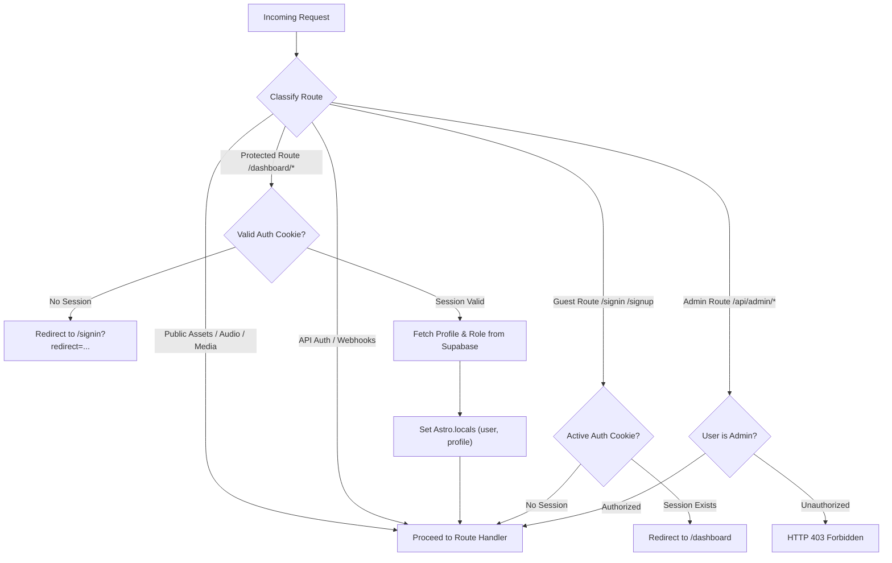
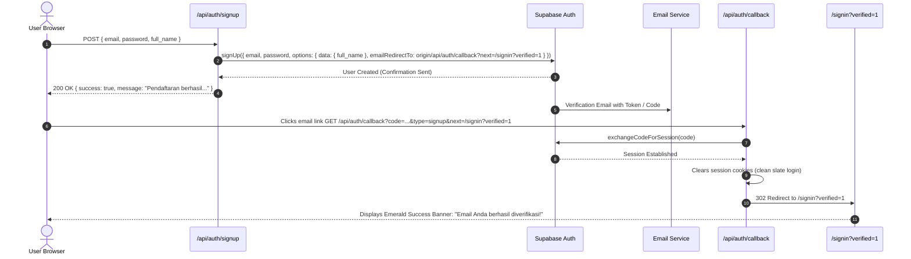
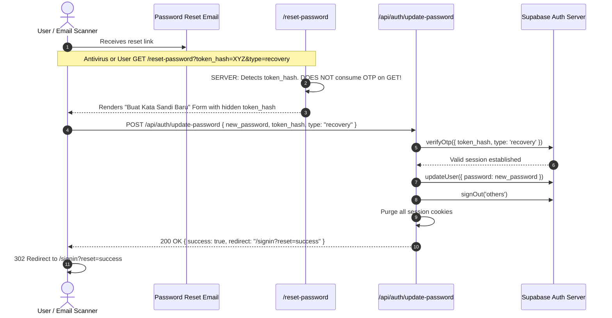
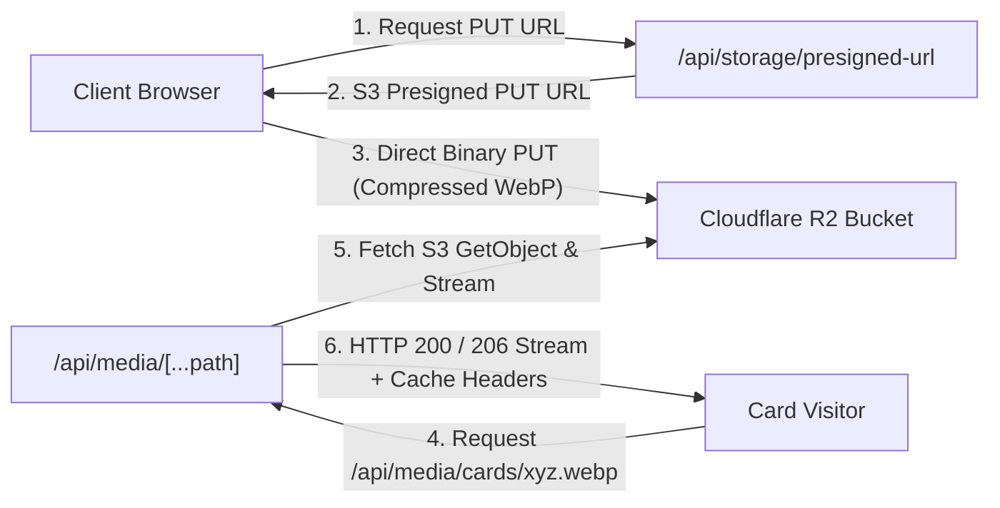
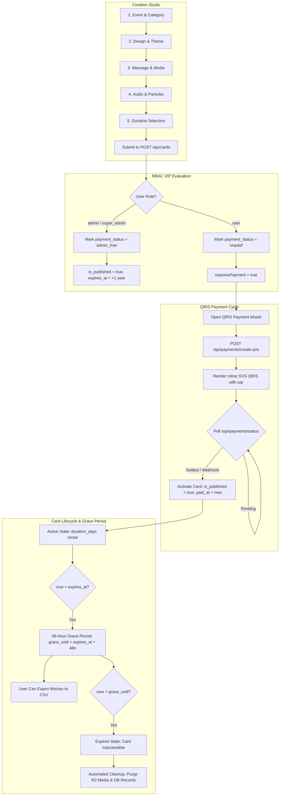

# PROJECT_CONTEXT.md — CelebrateLoop Codebase Technical Documentation

> **Status:** Active Production Reference  
> **Last Updated:** November 2026  
> **Target Audience:** Autonomous Coding Agents, Technical Leads, and System Architects  
> **Security Notice:** All sensitive values, credentials, and secrets are strictly redacted (`<REDACTED>`). Never log, commit, or print private credentials.

---

## 1. Project Overview & Architecture

### 1.1 Product Identity & Core Purpose
**CelebrateLoop** (`celebrateloop`) is an Indonesian digital event greeting card and invitation SaaS platform. It enables users to create, customize, preview, publish, and share immersive multimedia greeting cards (weddings, birthdays, anniversaries, graduations, corporate invitations, romantic cards, and general greetings) accessible via vanity slugs (`/c/[slug]`).

The platform incorporates:
- Interactive envelopes, wax seals, and ambient visual effects (confetti, sakura petals, sparkles, romantic hearts, floating balloons).
- Real-time client-side live preview during creation.
- Multi-tier background audio (bundled low-latency Opus tracks or procedural Web Audio API synthesis).
- Public RSVP and guestbook wish submissions with real-time UI updates.
- 6 duration-based rental tiers (3, 7, 14, 30, 45, and 60 days) backed by dynamic Indonesian QRIS (Quick Response Code Indonesian Standard) payments.
- 48-hour post-expiry grace period allowing card owners to export guest wishes to CSV.
- Automated garbage collection that purges expired assets from Cloudflare R2 and Supabase PostgreSQL.
- 3-tier Role-Based Access Control (`user`, `admin`, `super_admin`) with an immortal root owner (`lesynugraha@gmail.com`) and VIP free card creation bypass.

---

### 1.2 Tech Stack & Version Matrix

| Technology | Version | Purpose & Architecture Role |
| :--- | :--- | :--- |
| **Astro** | `^5.2.0` | Modern web framework operating in full Server-Side Rendering mode (`output: 'server'`). Handles SSR page generation, edge middleware, and REST API routing. |
| **Cloudflare Adapter** | `@astrojs/cloudflare` `^12.6.13` | Cloudflare Pages and Workers edge adapter with `nodejs_compat` compatibility flag. |
| **Tailwind CSS** | `^4.0.0` | Next-generation utility-first CSS framework configured via `@tailwindcss/vite` plugin and `@import "tailwindcss";` in `src/styles/global.css`. Uses Tailwind v4 theme variables. |
| **TypeScript** | `^5.7.3` | Strict static typing across all modules, API handlers, and Astro components. |
| **Supabase JS** | `@supabase/supabase-js` `^2.48.0` | Client and server communication with Supabase PostgreSQL, GoTrue Auth, and Row-Level Security (RLS). |
| **AWS S3 Client** | `@aws-sdk/client-s3` `^3.731.1` & `@aws-sdk/s3-request-presigner` | Direct presigned URL generation and bucket lifecycle management for Cloudflare R2 object storage. |
| **Image Compression** | `browser-image-compression` `^2.0.2` | In-browser client-side image compression prior to direct R2 presigned PUT upload (WebP, $\le 200\text{ KB}$, max 1280px). |
| **Micro QR Generator** | `uqr` `^0.1.2` | Pure JavaScript zero-dependency QR matrix computation for rendering SVG QRIS codes directly in the DOM. |
| **Audio Processing** | Web Audio API & Native HTML5 Audio | Dual-engine audio playback: hardware-accelerated Opus audio tracks or procedural harmonic sound synthesis. |

---

### 1.3 Cloudflare Pages / Workers V8 Runtime Architecture

CelebrateLoop is engineered specifically for the Cloudflare Workers V8 isolated execution environment:
1. **Server-Side Rendering (`output: 'server'`)**: Every route (`/`, `/signin`, `/dashboard/**`, `/c/[slug]`) and API endpoint (`/api/**`) executes on edge Workers at request time.
2. **Compatibility & Node.js Emulation**: Configured in `wrangler.toml` with `compatibility_flags = ["nodejs_compat"]`. Web standard primitives (`Request`, `Response`, `fetch`, `Headers`, `ReadableStream`, `crypto.subtle`) are preferred over Node.js native globals.
3. **Image Service**: Configured with `image: { service: { entrypoint: 'passthrough' } }` in `astro.config.mjs` to bypass local Sharp binary dependencies incompatible with V8 worker sandboxes.
4. **Edge Media Streaming Proxy**: Direct public access to Cloudflare R2 buckets is blocked. Media assets are streamed through an edge reverse proxy (`/api/media/[...path]`) with path traversal guards, HTTP range support, and aggressive client caching headers (`Cache-Control: public, max-age=31536000, immutable`).

---

## 2. Complete Annotated Directory Tree

```
celebrateloop/
├── .gitignore                                  # Git exclusion rules (node_modules, dist, .astro, .wrangler, .env)
├── astro.config.mjs                            # Astro 5 core configuration with @astrojs/cloudflare & Tailwind Vite plugin
├── package.json                                # Project dependencies, scripts, and package metadata
├── package-lock.json                           # Exact dependency lockfile
├── tsconfig.json                               # Strict TypeScript configuration extending astro/tsconfigs/strict
├── wrangler.toml                               # Cloudflare Pages deployment configuration and compatibility settings
├── PROJECT_CONTEXT.md                          # Comprehensive technical architecture & codebase reference (this document)
├── PROJECT_OVERVIEW.md                         # High-level product summary and functional vision
├── SYSTEM_CONTEXT.md                           # System context and infrastructure map
│
├── public/                                     # Static public assets served directly by the edge host
│   ├── favicon.svg                             # Scalable vector heart-loop favicon
│   ├── favicon.png                             # Fallback raster PNG favicon (32x32)
│   ├── logo-icon.png                           # Brand logo icon graphic
│   └── audio/                                  # Bundled royalty-free audio tracks (Opus format, 48kHz, optimized)
│       ├── .gitkeep                            # Git directory preservation marker
│       ├── README.md                           # Audio track attribution and compression documentation
│       ├── anniversary.opus                    # Warm acoustic romantic guitar theme
│       ├── birthday.opus                       # Upbeat festive celebration theme
│       ├── graduation.opus                     # Uplifting inspiring orchestral theme
│       ├── greetings.opus                      # Gentle ambient acoustic theme
│       ├── invitation.opus                     # Elegant classy neoclassical theme
│       ├── love.opus                           # Soft cinematic romantic piano theme
│       └── wedding.opus                        # Majestic romantic wedding march acoustic theme
│
├── supabase/                                   # Database migrations tracking database evolution
│   └── migrations/
│       ├── 001_initial_schema.sql              # Initial profiles, cards, wishes tables, triggers, and RLS policies
│       ├── 002_add_avatar_url_to_profiles.sql  # Adds avatar_url column to profiles table
│       ├── 003_add_phone_number_to_profiles.sql# Adds phone_number column to profiles table
│       ├── 004_rbac_pricing_qris_cleanup.sql   # Adds roles, duration pricing, transactions table, and RLS
│       └── 005_three_tier_rbac.sql             # 3-tier RBAC check constraint and immortal super_admin enforcement
│
├── src/                                        # Application source code
│   ├── env.d.ts                                # TypeScript ambient definitions for Astro, Cloudflare runtime, and Env
│   ├── middleware.ts                           # Edge request interceptor: auth validation, RBAC context, route guard
│   │
│   ├── db/
│   │   └── schema.sql                          # Consolidated canonical PostgreSQL database schema reference
│   │
│   ├── styles/
│   │   └── global.css                          # Global styles, Tailwind v4 import, custom @theme tokens & keyframes
│   │
│   ├── lib/                                    # Shared business logic, utilities, client wrappers, and constants
│   │   ├── audio-tracks.ts                     # Bundled Opus audio metadata catalog and playback helpers
│   │   ├── cleanup-expired.ts                  # Automated garbage collection for expired cards and orphaned R2 objects
│   │   ├── corner-ornaments.ts                 # Algorithmic SVG corner ornament generators for greeting card frames
│   │   ├── image-compress.ts                   # Client-side image compression wrapper (WebP, ≤200KB, max 1280px)
│   │   ├── pricing.ts                          # 6 official duration tiers (3, 7, 14, 30, 45, 60 days) and pricing logic
│   │   ├── qris.ts                             # Bank Indonesia EMVCo standard dynamic QRIS generator with CRC16
│   │   ├── r2.ts                               # Cloudflare R2 S3 client, presigned URL generator, and delete helpers
│   │   ├── showcase-wedding.ts                 # Default mock wedding dataset for the landing page interactive preview
│   │   ├── slug.ts                             # URL slug generator with random suffix and sanitization
│   │   ├── supabase.ts                         # Edge/SSR Supabase server client, admin client, and cookie parsers
│   │   ├── supabase-browser.ts                 # Browser singleton Supabase client with auth state synchronization
│   │   ├── synth-audio.ts                      # Procedural Web Audio API sound synthesis (piano, bells, ambient chords)
│   │   └── types.ts                            # Universal TypeScript types, database interfaces, and RBAC guards
│   │
│   ├── components/                             # Reusable Astro UI and structural components
│   │   ├── layout/
│   │   │   ├── BaseLayout.astro                # Standard root HTML document shell with SEO meta and theme background
│   │   │   ├── DashboardLayout.astro           # Authenticated user dashboard shell with sidebar, topbar, and user pill
│   │   │   ├── Footer.astro                    # Global footer with navigation links, branding, and copyright
│   │   │   └── Navbar.astro                    # Responsive top navigation bar with auth status and mobile hamburger
│   │   └── ui/
│   │       ├── AmbientEffect.astro             # Fullscreen particle animator (confetti, petals, hearts, balloons, stars)
│   │       ├── Badge.astro                     # Color-coded pill badge component for statuses and categories
│   │       ├── Button.astro                    # Multi-variant button component (primary, secondary, danger, ghost)
│   │       ├── Card.astro                      # Glassmorphic container card with subtle borders and glow effects
│   │       ├── CornerOrnaments.astro           # SVG corner embellishments for cards (classic, floral, modern, royal)
│   │       ├── Input.astro                     # Accessible text input, textarea, and select form field component
│   │       ├── Modal.astro                     # Accessible modal dialog with scroll-safe inner panel and backdrop
│   │       └── Toast.astro                     # Lightweight client toast notification dispatcher and DOM container
│   │
│   ├── layouts/                                # Deprecated/compatibility layout wrappers
│   │   ├── BaseLayout.astro                    # Alias redirecting to components/layout/BaseLayout.astro
│   │   └── Layout.astro                        # Root layout wrapper for standalone pages
│   │
│   └── pages/                                  # Application routes and API endpoints (Astro File-based Routing)
│       ├── index.astro                         # Marketing landing page with hero, live interactive showcase, pricing
│       ├── login.astro                         # Legacy login redirecting to /signin
│       ├── signin.astro                        # User login page with credentials, verification alerts, forgot modal
│       ├── signup.astro                        # User registration page with real-time password strength validation
│       ├── reset-password.astro                # Stateless multi-flow password recovery and reset page
│       ├── privacy.astro                       # Privacy policy document
│       ├── terms.astro                         # Terms of service document
│       │
│       ├── c/
│       │   └── [slug].astro                    # Public interactive greeting card viewer (envelope, audio, RSVP, wishes)
│       │
│       ├── dashboard/
│       │   ├── index.astro                     # Dashboard main page: user card listing, QRIS payment modal, analytics
│       │   ├── create.astro                    # 5-step Creation Studio wizard with real-time synchronized live preview
│       │   └── profile.astro                   # User profile management: full name, phone, avatar, password, deletion
│       │
│       └── api/                                # Backend REST API endpoints (Edge Functions)
│           ├── admin/
│           │   └── roles.ts                    # RBAC role management (GET all users, POST/PATCH assign role)
│           ├── auth/
│           │   ├── callback.ts                 # Auth redirect callback handler for OAuth and email verification
│           │   ├── forgot-password.ts          # Initiates Supabase password recovery email
│           │   ├── login.ts                    # Password authentication endpoint setting SSR session cookies
│           │   ├── logout.ts                   # Session revocation endpoint clearing all auth cookies
│           │   ├── magic-link.ts               # Deprecated magic link endpoint (returns deprecation notice)
│           │   ├── signup.ts                   # Account creation endpoint with verification email redirection
│           │   └── update-password.ts          # Atomic password reset handler supporting stateless token_hash
│           ├── cards/
│           │   ├── index.ts                    # List user cards (GET) and create new card (POST)
│           │   ├── [id].ts                     # Get single card (GET), update card (PUT), and delete card (DELETE)
│           │   ├── by-slug/
│           │   │   └── [slug].ts               # Fetch public card by slug for SSR viewer
│           │   └── [id]/
│           │       └── wishes-export.ts        # Export card guest wishes to downloadable RFC 4180 CSV
│           ├── media/
│           │   └── [...path].ts                # Streaming edge media proxy for R2 assets with path traversal guard
│           ├── payments/
│           │   ├── create-qris.ts              # Generate dynamic EMVCo QRIS transaction for card duration activation
│           │   ├── status.ts                   # Poll payment transaction settlement status
│           │   └── webhook.ts                  # Payment gateway webhook callback for automatic transaction settlement
│           ├── profile/
│           │   ├── change-password.ts          # Authenticated user in-app password update endpoint
│           │   ├── delete-account.ts           # Complete user account deletion and cascade data purge
│           │   └── update.ts                   # Update user profile metadata (full name, phone, avatar URL)
│           ├── storage/
│           │   └── presigned-url.ts            # Generate AWS S3 presigned PUT URLs for direct client-to-R2 uploads
│           └── wishes/
│               └── [cardId].ts                 # Fetch card wishes (GET) and submit guest wish/RSVP (POST)
```

---

## 3. Authentication, Session & Middleware Lifecycle

### 3.1 Auth Architecture & Dual Cookie Management
CelebrateLoop uses Supabase GoTrue authentication configured for full Server-Side Rendering (SSR). Session state is persisted across HTTP requests using dual secure cookies:
1. `sb-access-token`: JWT access token issued by Supabase GoTrue containing user claims (`sub`, `email`, `role`, `exp`).
2. `sb-refresh-token`: High-entropy opaque refresh token used to rotate expired access tokens.

#### Cookie Storage Attributes
When cookies are written by API endpoints (`/api/auth/login`, `/api/auth/callback`, `/api/auth/update-password`), they are configured with strict security flags:
```typescript
{
  path: '/',
  httpOnly: true,
  sameSite: 'lax',
  secure: import.meta.env.PROD, // true in production HTTPS
  maxAge: 60 * 60 * 24 * 7      // 7 days
}
```

#### Dual Client Model
The application maintains three distinct Supabase client configurations in `src/lib/supabase.ts` and `src/lib/supabase-browser.ts`:
1. **Server Client (`createServerSupabaseClient(request)`)**: Extracts cookies from the incoming HTTP `Request` headers. Used in SSR pages and API routes to perform operations within the caller's RLS security context.
2. **Admin Service Client (`createAdminSupabaseClient()`)**: Instantiated using `SUPABASE_SERVICE_ROLE_KEY`. Bypasses RLS. Used exclusively for administrative tasks: automated expired card cleanup, webhook order settlement, account deletion cascading, and user profile role elevation.
3. **Browser Client (`supabaseBrowser`)**: Client-side singleton in `src/lib/supabase-browser.ts`. Synchronizes auth state changes (`SIGNED_IN`, `SIGNED_OUT`, `TOKEN_REFRESHED`) with document cookies via `document.cookie`.

---

### 3.2 Middleware Interception Pipeline (`src/middleware.ts`)

Every incoming request to the Cloudflare Workers edge passes through `src/middleware.ts`:



#### Middleware Route Classification Matrix

| Route Category | Path Patterns | Unauthenticated Behavior | Authenticated Behavior |
| :--- | :--- | :--- | :--- |
| **Public Assets** | `/favicon.*`, `/_astro/*`, `/audio/*`, `/api/media/*` | Passthrough directly. | Passthrough directly. |
| **Public Endpoints** | `/`, `/privacy`, `/terms`, `/c/[slug]`, `/api/wishes/*`, `/api/cards/by-slug/*`, `/api/payments/webhook` | Passthrough directly. | Passthrough directly (populates `locals.user` if session exists). |
| **Guest-Only Routes** | `/signin`, `/signup`, `/login` | Passthrough to auth forms. | 302 Redirect to `/dashboard`. |
| **Protected Routes** | `/dashboard`, `/dashboard/create`, `/dashboard/profile` | 302 Redirect to `/signin?redirect=${pathname}`. | Sets `locals.user` & `locals.profile`, proceeds to page. |
| **Admin-Only APIs** | `/api/admin/*` | Returns HTTP 401 Unauthorized (`{ error: 'Unauthorized' }`). | Verifies `role === 'admin' \|\| role === 'super_admin'`. Returns 403 if insufficient. |

---

### 3.3 Registration & Email Verification Lifecycle



1. **User Submission**: User registers via `/signup`. Client submits credentials to `POST /api/auth/signup`.
2. **Explicit Verification Target**: The endpoint forces `options.emailRedirectTo = ${origin}/api/auth/callback?next=/signin?verified=1`.
3. **Database Profile Trigger**: Supabase's `on_auth_user_created` trigger automatically provisions a matching row in `public.profiles` (`id = user.id, email = user.email, full_name = user.raw_user_meta_data->>'full_name', role = 'user'`).
4. **Callback Exchange**: When clicked, `/api/auth/callback` verifies the authorization code. Because `type === 'signup'` or `next` points to `/signin`, it deliberately purges intermediate session cookies and redirects cleanly to `/signin?verified=1`.
5. **Banner Rendering**: `src/pages/signin.astro` inspects `Astro.url.searchParams.get('verified') === '1'` and renders a prominent emerald notice: *"Email Anda berhasil diverifikasi! Silakan masuk menggunakan email dan kata sandi Anda."*

---

### 3.4 Stateless `token_hash` & Multi-Flow Password Recovery

Password recovery systems frequently fail in corporate or mobile environments due to antivirus scanners pre-fetching links or in-app webviews dropping cookie state. CelebrateLoop solves this with a **Stateless Token Preservation Architecture**:



#### Why Tokens Are Never Consumed on GET
Anti-phishing bots and mobile email clients (Gmail, Outlook, WhatsApp) aggressively pre-render inbound URLs. If an endpoint calls `verifyOtp()` on a `GET` request, the single-use OTP is permanently consumed before the user ever sees the form.
CelebrateLoop guarantees:
1. `src/pages/reset-password.astro` evaluates query parameters (`token_hash`, `code`, `type`) during SSR. If present, it **immediately renders the password input form** without contacting the auth server.
2. The `token_hash` is injected into a hidden form input `<input type="hidden" name="token_hash" value="...">`.
3. The client submission to `POST /api/auth/update-password` executes a prioritized 4-tier verification waterfall:
   - **Tier 1 (`token_hash`)**: Executes `supabase.auth.verifyOtp({ token_hash, type: 'recovery' })`.
   - **Tier 2 (`code`)**: Executes `supabase.auth.exchangeCodeForSession(code)`.
   - **Tier 3 (`access_token` & `refresh_token`)**: Executes `supabase.auth.setSession({ access_token, refresh_token })` (handles client hash fragments `#access_token=...`).
   - **Tier 4 (Cookie Session)**: Validates existing `sb-access-token` session.
4. Once verified, `supabase.auth.updateUser({ password: newPassword })` updates the user's credentials.
5. All sessions are invalidated, auth cookies are cleared, and the user is redirected to `/signin?reset=success`.
6. `/signin.astro` detects `?reset=success` and displays an emerald confirmation banner: *"Kata sandi berhasil diperbarui! Silakan masuk dengan kata sandi baru Anda."*

---

### 3.5 3-Tier Role-Based Access Control (RBAC)

The platform implements a strict 3-tier hierarchy:
```
           ┌──────────────────────┐
           │     super_admin      │  Immortal Root Owner (lesynugraha@gmail.com)
           └──────────┬───────────┘  Can promote/demote admins, delete accounts, bypass payments
                      │
           ┌──────────▼───────────┐
           │        admin         │  Internal Team & Customer Service
           └──────────┬───────────┘  Can promote users to admin, VIP free cards (payment_status = 'admin_free')
                      │
           ┌──────────▼───────────┐
           │         user         │  Regular Public Customers
           └──────────────────────┘  Must pay via QRIS to publish cards
```

#### Immortal Root Owner Safeguard
To prevent accidental lockouts, `lesynugraha@gmail.com` is permanently protected in code and database constraints:
- In `src/lib/types.ts`:
  ```typescript
  export const IMMORTAL_SUPER_ADMIN_EMAIL = 'lesynugraha@gmail.com';

  export function isSuperAdmin(profile?: { role?: UserRole; email?: string | null } | null): boolean {
    if (!profile) return false;
    return profile.email === IMMORTAL_SUPER_ADMIN_EMAIL || profile.role === 'super_admin';
  }

  export function isAdminOrSuperAdmin(profile?: { role?: UserRole; email?: string | null } | null): boolean {
    if (!profile) return false;
    return profile.email === IMMORTAL_SUPER_ADMIN_EMAIL || profile.role === 'admin' || profile.role === 'super_admin';
  }
  ```
- In `src/pages/api/admin/roles.ts`:
  - Any attempt to demote `lesynugraha@gmail.com` throws HTTP 403 Forbidden: *"Root owner immortal super_admin tidak dapat diubah"*.
  - Regular `admin` users cannot promote or demote anyone to/from `super_admin`.
- In `src/pages/api/profile/delete-account.ts`:
  - `lesynugraha@gmail.com` cannot be deleted under any circumstance.

#### Admin VIP Bypass for Greeting Cards
When an `admin` or `super_admin` creates a greeting card via `POST /api/cards`:
- `payment_status` is automatically set to `'admin_free'`.
- `is_published` is immediately set to `true`.
- `duration_days` defaults to 365 days.
- `expires_at` is set to 1 year in the future.
- The API response returns `requiresPayment: false`, allowing admins to publish and share cards instantly without triggering QRIS.

---

## 4. Database Schema, Supabase & Storage Architecture

### 4.1 Canonical Database Schema (`src/db/schema.sql`)

```sql
-- PostgreSQL Canonical Schema for CelebrateLoop

-- Enable UUID generation extension
CREATE EXTENSION IF NOT EXISTS "uuid-ossp";

-- ============================================================================
-- 1. PROFILES TABLE
-- ============================================================================
CREATE TABLE public.profiles (
    id UUID PRIMARY KEY REFERENCES auth.users(id) ON DELETE CASCADE,
    email TEXT NOT NULL,
    full_name TEXT,
    avatar_url TEXT,
    phone_number TEXT,
    role TEXT NOT NULL DEFAULT 'user' CHECK (role IN ('user', 'admin', 'super_admin')),
    created_at TIMESTAMPTZ NOT NULL DEFAULT timezone('utc'::text, now())
);

CREATE INDEX idx_profiles_email ON public.profiles(email);
CREATE INDEX idx_profiles_role ON public.profiles(role);

-- ============================================================================
-- 2. CARDS TABLE
-- ============================================================================
CREATE TABLE public.cards (
    id UUID PRIMARY KEY DEFAULT uuid_generate_v4(),
    user_id UUID NOT NULL REFERENCES public.profiles(id) ON DELETE CASCADE,
    slug TEXT NOT NULL UNIQUE,
    category TEXT NOT NULL CHECK (category IN ('wedding', 'birthday', 'anniversary', 'graduation', 'invitation', 'love', 'greetings')),
    recipient_name TEXT NOT NULL,
    sender_name TEXT NOT NULL,
    message TEXT NOT NULL,
    event_date TIMESTAMPTZ,
    theme_config JSONB NOT NULL DEFAULT '{}'::jsonb,
    media_urls TEXT[] NOT NULL DEFAULT '{}'::text[],
    is_published BOOLEAN NOT NULL DEFAULT false,
    payment_status TEXT NOT NULL DEFAULT 'unpaid' CHECK (payment_status IN ('unpaid', 'paid', 'admin_free', 'expired')),
    duration_days INTEGER NOT NULL DEFAULT 7,
    paid_at TIMESTAMPTZ,
    expires_at TIMESTAMPTZ,
    grace_until TIMESTAMPTZ,
    created_at TIMESTAMPTZ NOT NULL DEFAULT timezone('utc'::text, now())
);

CREATE INDEX idx_cards_user_id ON public.cards(user_id);
CREATE UNIQUE INDEX idx_cards_slug ON public.cards(slug);
CREATE INDEX idx_cards_category ON public.cards(category);
CREATE INDEX idx_cards_payment_status ON public.cards(payment_status);
CREATE INDEX idx_cards_expires_at ON public.cards(expires_at);
CREATE INDEX idx_cards_grace_until ON public.cards(grace_until);

-- ============================================================================
-- 3. TRANSACTIONS TABLE
-- ============================================================================
CREATE TABLE public.transactions (
    id UUID PRIMARY KEY DEFAULT uuid_generate_v4(),
    order_id TEXT NOT NULL UNIQUE,
    card_id UUID NOT NULL REFERENCES public.cards(id) ON DELETE CASCADE,
    user_id UUID NOT NULL REFERENCES public.profiles(id) ON DELETE CASCADE,
    amount NUMERIC NOT NULL,
    duration_days INTEGER NOT NULL,
    status TEXT NOT NULL DEFAULT 'pending' CHECK (status IN ('pending', 'settled', 'expired', 'failed')),
    payment_method TEXT NOT NULL DEFAULT 'qris',
    qr_string TEXT,
    gateway_provider TEXT DEFAULT 'manual_simulation',
    gateway_reference TEXT,
    created_at TIMESTAMPTZ NOT NULL DEFAULT timezone('utc'::text, now()),
    settled_at TIMESTAMPTZ
);

CREATE INDEX idx_transactions_order_id ON public.transactions(order_id);
CREATE INDEX idx_transactions_card_id ON public.transactions(card_id);
CREATE INDEX idx_transactions_user_id ON public.transactions(user_id);
CREATE INDEX idx_transactions_status ON public.transactions(status);

-- ============================================================================
-- 4. WISHES TABLE (Guestbook & RSVP)
-- ============================================================================
CREATE TABLE public.wishes (
    id UUID PRIMARY KEY DEFAULT uuid_generate_v4(),
    card_id UUID NOT NULL REFERENCES public.cards(id) ON DELETE CASCADE,
    sender_name TEXT NOT NULL,
    message TEXT NOT NULL,
    attendance TEXT NOT NULL DEFAULT 'present' CHECK (attendance IN ('present', 'absent', 'uncertain')),
    created_at TIMESTAMPTZ NOT NULL DEFAULT timezone('utc'::text, now())
);

CREATE INDEX idx_wishes_card_id ON public.wishes(card_id);
CREATE INDEX idx_wishes_created_at ON public.wishes(created_at DESC);
```

---

### 4.2 Row-Level Security (RLS) Policies

All tables have Row-Level Security enabled (`ALTER TABLE ... ENABLE ROW LEVEL SECURITY`).

```sql
-- Profiles RLS
CREATE POLICY "Public profiles are viewable by everyone" 
ON public.profiles FOR SELECT USING (true);

CREATE POLICY "Users can update own profile" 
ON public.profiles FOR UPDATE USING (auth.uid() = id);

-- Cards RLS
CREATE POLICY "Public cards viewable if published or within grace period" 
ON public.cards FOR SELECT 
USING (
    is_published = true 
    OR auth.uid() = user_id 
    OR (grace_until IS NOT NULL AND grace_until > timezone('utc'::text, now()))
);

CREATE POLICY "Users can insert own cards" 
ON public.cards FOR INSERT WITH CHECK (auth.uid() = user_id);

CREATE POLICY "Users can update own cards" 
ON public.cards FOR UPDATE USING (auth.uid() = user_id);

CREATE POLICY "Users can delete own cards" 
ON public.cards FOR DELETE USING (auth.uid() = user_id);

-- Transactions RLS
CREATE POLICY "Users can view own transactions" 
ON public.transactions FOR SELECT USING (auth.uid() = user_id);

CREATE POLICY "Users can insert own transactions" 
ON public.transactions FOR INSERT WITH CHECK (auth.uid() = user_id);

-- Wishes RLS
CREATE POLICY "Anyone can view wishes for a card" 
ON public.wishes FOR SELECT USING (true);

CREATE POLICY "Anyone can submit a wish for an active card" 
ON public.wishes FOR INSERT WITH CHECK (
    EXISTS (
        SELECT 1 FROM public.cards 
        WHERE id = card_id 
        AND (is_published = true OR payment_status IN ('paid', 'admin_free'))
    )
);

CREATE POLICY "Card owner can delete wishes" 
ON public.wishes FOR DELETE USING (
    EXISTS (
        SELECT 1 FROM public.cards 
        WHERE id = card_id AND user_id = auth.uid()
    )
);
```

---

### 4.3 Database Trigger: New User Provisioning
When an identity is registered via Supabase Auth, a PostgreSQL trigger fires to create the profile:
```sql
CREATE OR REPLACE FUNCTION public.handle_new_user()
RETURNS trigger AS $$
BEGIN
  INSERT INTO public.profiles (id, email, full_name, role)
  VALUES (
    new.id,
    new.email,
    new.raw_user_meta_data->>'full_name',
    'user'
  );
  RETURN new;
END;
$$ LANGUAGE plpgsql SECURITY DEFINER;

CREATE OR REPLACE TRIGGER on_auth_user_created
  AFTER INSERT ON auth.users
  FOR EACH ROW EXECUTE FUNCTION public.handle_new_user();
```

---

### 4.4 Cloudflare R2 Object Storage Architecture

CelebrateLoop integrates with Cloudflare R2 via `@aws-sdk/client-s3`. To maintain edge security and minimize egress latency, direct public bucket access is disabled.



#### Presigned Upload Workflow
1. Client compresses image using `browser-image-compression` (WebP, $\le 200\text{ KB}$, max 1280px).
2. Client requests a presigned PUT URL from `POST /api/storage/presigned-url`.
3. The server generates a key under `cards/{userId}/{uuid}.webp` or `avatars/{userId}/{uuid}.webp` with a 15-minute expiration window.
4. Client executes an HTTP `PUT` directly to R2 using the presigned URL.

#### Edge Streaming Media Proxy (`/api/media/[...path]`)
- **Path Traversal Protection**: Rejects any path containing `..`, `\`, or null bytes.
- **Whitelist Prefix Enforcement**: Validates that keys begin with permitted folders: `cards/`, `avatars/`, or `audio/`.
- **Streaming & Caching**: Emits `ReadableStream` directly to the client with `Cache-Control: public, max-age=31536000, immutable`. Supports `Range` requests for audio and media scrubbing.

---

## 5. API Endpoints Reference (`src/pages/api/**`)

Every API endpoint is an Astro Server Route exporting an `APIRoute` handler (`GET`, `POST`, `PUT`, `DELETE`, `PATCH`). All endpoints return consistent JSON payloads and appropriate HTTP status codes.

### 5.1 Authentication APIs

#### 1. `POST /api/auth/signup`
- **Auth**: Public (Anonymous)
- **Request Body**:
  ```json
  {
    "email": "user@example.com",
    "password": "SecurePassword123",
    "full_name": "Budi Santoso"
  }
  ```
- **Internal Logic**: Validates email format and password length ($\ge 6$). Computes `emailRedirectTo = ${origin}/api/auth/callback?next=/signin?verified=1`. Calls `supabase.auth.signUp()`.
- **Response**:
  - `200 OK`: `{ "success": true, "message": "Pendaftaran berhasil! Silakan periksa email Anda untuk konfirmasi akun." }`
  - `400 Bad Request`: `{ "error": "Email dan kata sandi (minimal 6 karakter) wajib diisi" }`

#### 2. `POST /api/auth/login`
- **Auth**: Public
- **Request Body**:
  ```json
  {
    "email": "user@example.com",
    "password": "SecurePassword123"
  }
  ```
- **Internal Logic**: Calls `supabase.auth.signInWithPassword()`. On success, extracts `session.access_token` and `session.refresh_token`. Sets `sb-access-token` and `sb-refresh-token` cookies.
- **Response**:
  - `200 OK`: `{ "success": true, "user": { "id": "...", "email": "..." } }`
  - `401 Unauthorized`: `{ "error": "Email atau kata sandi salah" }`

#### 3. `POST /api/auth/logout`
- **Auth**: Authenticated User
- **Internal Logic**: Calls `supabase.auth.signOut()`. Deletes `sb-access-token` and `sb-refresh-token` cookies by setting `maxAge: 0`.
- **Response**:
  - `200 OK`: `{ "success": true, "message": "Berhasil keluar" }`

#### 4. `GET /api/auth/callback`
- **Auth**: Public (Invoked by auth redirect links)
- **Query Parameters**: `code`, `token_hash`, `type`, `next`
- **Internal Logic**:
  - If `token_hash` is present with `type === 'recovery'`, preserves the token and forwards directly to `/reset-password?token_hash=...&type=recovery` without consuming it on GET.
  - If `code` is present, calls `exchangeCodeForSession(code)`. If `type === 'signup'` or `next` includes `/signin`, clears session cookies and redirects to `/signin?verified=1`.
- **Response**:
  - `302 Redirect` to target destination.

#### 5. `POST /api/auth/forgot-password`
- **Auth**: Public
- **Request Body**:
  ```json
  { "email": "user@example.com" }
  ```
- **Internal Logic**: Calls `supabase.auth.resetPasswordForEmail(email, { redirectTo: `${origin}/reset-password` })`.
- **Response**:
  - `200 OK`: `{ "success": true, "message": "Tautan pemulihan kata sandi telah dikirim ke email Anda." }`

#### 6. `POST /api/auth/update-password`
- **Auth**: Recovery Token / Code / Session / Cookies
- **Request Body**:
  ```json
  {
    "new_password": "NewSecurePassword456",
    "token_hash": "optional_token_hash",
    "code": "optional_pkce_code",
    "access_token": "optional_access_token",
    "refresh_token": "optional_refresh_token"
  }
  ```
- **Internal Logic**: Executes 4-tier authentication fallback (`token_hash` $\to$ `code` $\to$ `access_token` $\to$ cookie session). Calls `supabase.auth.updateUser({ password: new_password })`. Calls `supabase.auth.signOut('others')`, clears cookies, and returns redirect directive.
- **Response**:
  - `200 OK`: `{ "success": true, "redirect": "/signin?reset=success", "message": "Kata sandi berhasil diperbarui" }`
  - `400 Bad Request`: `{ "error": "Token atau sesi pemulihan tidak valid atau sudah kedaluwarsa" }`

#### 7. `POST /api/auth/magic-link`
- **Auth**: Deprecated
- **Internal Logic**: Returns HTTP 410 Gone / 400 Bad Request informing callers that magic links are deprecated in favor of password login.

---

### 5.2 Card Management APIs

#### 8. `GET /api/cards`
- **Auth**: Authenticated User
- **Internal Logic**: Queries `public.cards` where `user_id = user.id` ordered by `created_at DESC`. Automatically evaluates expired statuses and grace periods.
- **Response**:
  - `200 OK`: `{ "cards": [ ...Card objects... ] }`

#### 9. `POST /api/cards`
- **Auth**: Authenticated User
- **Request Body**:
  ```json
  {
    "category": "wedding",
    "recipient_name": "Rama & Shinta",
    "sender_name": "Keluarga Besar Budi",
    "message": "Selamat menempuh hidup baru...",
    "event_date": "2026-12-25T10:00:00Z",
    "theme_config": {
      "primaryColor": "rose",
      "fontHeading": "Playfair Display",
      "ornamentStyle": "floral",
      "ambientEffect": "sakura",
      "audioTrack": "wedding.opus"
    },
    "media_urls": ["/api/media/cards/..."],
    "duration_days": 7
  }
  ```
- **Internal Logic**:
  - Validates required fields and category enum.
  - Generates unique slug using `generateSlug(recipient_name)`.
  - Checks user role via `profiles`.
  - **Admin VIP Logic**: If `role === 'admin' || role === 'super_admin'`, sets `payment_status = 'admin_free'`, `is_published = true`, `duration_days = 365`, `expires_at = now() + 1 year`. Returns `requiresPayment: false`.
  - **Regular User Logic**: Sets `payment_status = 'unpaid'`, `is_published = false`. Returns `requiresPayment: true`.
- **Response**:
  - `201 Created`: `{ "card": { ... }, "requiresPayment": true, "slug": "rama-shinta-k39x" }`

#### 10. `GET /api/cards/[id]`
- **Auth**: Authenticated User (Owner)
- **Internal Logic**: Fetches single card by `id`. Confirms `user_id === user.id`.
- **Response**:
  - `200 OK`: `{ "card": { ... } }`
  - `404 Not Found`: `{ "error": "Kartu tidak ditemukan" }`

#### 11. `PUT /api/cards/[id]`
- **Auth**: Authenticated User (Owner)
- **Request Body**: Partial card fields (`recipient_name`, `sender_name`, `message`, `event_date`, `theme_config`, `media_urls`, `duration_days`).
- **Internal Logic**: Validates ownership. Updates row in `public.cards`.
- **Response**:
  - `200 OK`: `{ "card": { ... }, "message": "Kartu berhasil diperbarui" }`

#### 12. `DELETE /api/cards/[id]`
- **Auth**: Authenticated User (Owner or Admin)
- **Internal Logic**: Verifies ownership or admin status. Fetches card `media_urls` and deletes associated objects from Cloudflare R2 bucket. Deletes row from `public.cards` (cascades to `transactions` and `wishes`).
- **Response**:
  - `200 OK`: `{ "success": true, "message": "Kartu berhasil dihapus" }`

#### 13. `GET /api/cards/by-slug/[slug]`
- **Auth**: Public
- **Internal Logic**: Queries `public.cards` by `slug`. Allows viewing if `is_published = true`, or if card is in 48-hour grace period (`grace_until > now()`), or if requester is card owner.
- **Response**:
  - `200 OK`: `{ "card": { ... } }`
  - `404 Not Found`: `{ "error": "Kartu ucapan tidak ditemukan atau sudah kedaluwarsa" }`

#### 14. `GET /api/cards/[id]/wishes-export`
- **Auth**: Authenticated User (Owner)
- **Internal Logic**:
  - Verifies user owns the card.
  - Queries all wishes from `public.wishes` where `card_id = id` ordered by `created_at ASC`.
  - Generates RFC 4180 compliant CSV stream with UTF-8 BOM (`\uFEFF`) for Excel compatibility.
  - Columns: `"No"`, `"Nama Pengirim"`, `"Kehadiran"`, `"Ucapan & Doa"`, `"Waktu Kirim (UTC)"`.
- **Response**:
  - `200 OK` with headers:
    - `Content-Type: text/csv; charset=utf-8`
    - `Content-Disposition: attachment; filename="wishes-[slug]-[date].csv"`

---

### 5.3 Payment & QRIS APIs

#### 15. `POST /api/payments/create-qris`
- **Auth**: Authenticated User
- **Request Body**:
  ```json
  {
    "card_id": "uuid-v4-string",
    "duration_days": 7
  }
  ```
- **Internal Logic**:
  - Validates card ownership and verifies `duration_days` matches one of the 6 official tiers (`3, 7, 14, 30, 45, 60`).
  - Resolves price from `src/lib/pricing.ts` (e.g., 7 days $\to$ Rp10.000).
  - Generates unique order ID: `ELC-${Date.now()}-${randomAlphanumeric}`.
  - Computes Bank Indonesia standard EMVCo dynamic QRIS string with CRC16 checksum using `generateDynamicQRIS()`.
  - Inserts transaction record into `public.transactions` with `status = 'pending'`.
- **Response**:
  - `200 OK`:
    ```json
    {
      "success": true,
      "orderId": "ELC-1731234567-89AB",
      "amount": 10000,
      "durationDays": 7,
      "qrString": "00020101021226590014ID.LINKAJA.WWW011893600914...5802ID5919ELCELEBRATE DIGITAL6007JAKARTA6304ABCD",
      "isSimulation": true
    }
    ```

#### 16. `GET /api/payments/status?order_id=...`
- **Auth**: Authenticated User (Owner)
- **Internal Logic**: Queries `public.transactions` by `order_id`. Returns current settlement status.
- **Response**:
  - `200 OK`: `{ "status": "settled" | "pending" | "expired", "settled_at": "..." }`

#### 17. `POST /api/payments/webhook`
- **Auth**: Secret Key Verification (`x-webhook-secret` header or sandbox test signature)
- **Request Body**:
  ```json
  {
    "order_id": "ELC-1731234567-89AB",
    "status": "settled",
    "amount": 10000,
    "gateway_reference": "SIM-REF-12345"
  }
  ```
- **Internal Logic**:
  - Authenticates webhook signature.
  - Queries transaction and parent card.
  - Updates `public.transactions` row to `status = 'settled', settled_at = now()`.
  - Calculates card duration: `expires_at = now() + (duration_days * interval '1 day')`.
  - Calculates 48-hour grace period: `grace_until = expires_at + interval '48 hours'`.
  - Updates `public.cards` to `payment_status = 'paid', is_published = true, paid_at = now(), expires_at, grace_until`.
- **Response**:
  - `200 OK`: `{ "success": true, "message": "Pembayaran berhasil diproses dan kartu diaktifkan" }`

---

### 5.4 Profile & Administration APIs

#### 18. `POST /api/profile/update`
- **Auth**: Authenticated User
- **Request Body**: `{ "full_name": "...", "phone_number": "...", "avatar_url": "..." }`
- **Internal Logic**: Updates `full_name`, `phone_number`, and `avatar_url` in `public.profiles` for `auth.uid()`.
- **Response**:
  - `200 OK`: `{ "success": true, "profile": { ... } }`

#### 19. `POST /api/profile/change-password`
- **Auth**: Authenticated User
- **Request Body**: `{ "new_password": "...", "confirm_password": "..." }`
- **Internal Logic**: Validates matching passwords ($\ge 6$ chars). Calls `supabase.auth.updateUser({ password: new_password })`.
- **Response**:
  - `200 OK`: `{ "success": true, "message": "Kata sandi berhasil diperbarui" }`

#### 20. `POST /api/profile/delete-account`
- **Auth**: Authenticated User
- **Internal Logic**:
  - Prevents deletion if user is `lesynugraha@gmail.com`.
  - Queries all user cards and purges all uploaded media from Cloudflare R2.
  - Deletes user from Supabase GoTrue via Admin Client `deleteUser()`. Cascade foreign keys delete `profiles`, `cards`, `transactions`, and `wishes`.
  - Clears auth cookies.
- **Response**:
  - `200 OK`: `{ "success": true, "message": "Akun dan semua data terkait berhasil dihapus" }`

#### 21. `GET` & `POST/PATCH` `/api/admin/roles`
- **Auth**: Super Admin / Admin
- **`GET`**: Lists all users with their current roles and metadata.
- **`POST` / `PATCH` Request Body**:
  ```json
  {
    "target_user_id": "uuid-v4-string",
    "new_role": "admin"
  }
  ```
- **Internal Logic**:
  - Verifies caller has administrative privileges.
  - Blocks any modification to `lesynugraha@gmail.com`.
  - Enforces role hierarchy: standard `admin` cannot grant or revoke `super_admin`.
  - Updates `role` in `public.profiles`.
- **Response**:
  - `200 OK`: `{ "success": true, "message": "Peran pengguna berhasil diperbarui" }`
  - `403 Forbidden`: `{ "error": "Anda tidak memiliki izin untuk mengubah peran ini" }`

---

### 5.5 Storage & Guestbook APIs

#### 22. `POST /api/storage/presigned-url`
- **Auth**: Authenticated User
- **Request Body**: `{ "filename": "photo.jpg", "contentType": "image/webp", "folder": "cards" }`
- **Internal Logic**: Validates permitted folder (`cards` or `avatars`). Sanitizes filename and generates UUID key. Calls AWS S3 `getSignedUrl(s3Client, PutObjectCommand)`.
- **Response**:
  - `200 OK`: `{ "uploadUrl": "https://<account>.r2.cloudflarestorage.com/...", "publicUrl": "/api/media/cards/userId/uuid.webp", "key": "cards/userId/uuid.webp" }`

#### 23. `GET` & `POST` `/api/wishes/[cardId]`
- **Auth**: Public
- **`GET`**: Returns array of wishes for the given card ordered by `created_at DESC`.
- **`POST` Request Body**:
  ```json
  {
    "sender_name": "Tante Dewi",
    "message": "Selamat menempuh hidup baru Rama & Shinta! Bahagia selalu.",
    "attendance": "present"
  }
  ```
- **Internal Logic**: Verifies parent card is active (`is_published = true` or `payment_status IN ('paid', 'admin_free')`). Inserts row into `public.wishes`.
- **Response**:
  - `201 Created`: `{ "success": true, "wish": { ... } }`


---

## 6. File-by-File Source Code & Logic Breakdown

### 6.1 Root Configuration & Infrastructure Files

#### `astro.config.mjs`
- **Purpose**: Central Astro 5 framework configuration.
- **Key Modules & Adapters**:
  - `cloudflare({ imageService: 'passthrough' })`: Enables Cloudflare Pages/Workers SSR adapter. Disables local Sharp binary execution in favor of passthrough streaming.
  - `tailwindcss()` from `@tailwindcss/vite`: Integrates Tailwind CSS v4 directly into the Vite build pipeline.
  - `output: 'server'`: Directs Astro to run entirely in SSR mode; no static HTML pre-generation except for static public assets.

#### `wrangler.toml`
- **Purpose**: Cloudflare Pages / Workers deployment contract.
- **Settings**:
  - `name = "celebrateloop"`
  - `pages_build_output_dir = "dist"`
  - `compatibility_date = "2024-09-23"`
  - `compatibility_flags = ["nodejs_compat"]`: Exposes Node.js emulation APIs (such as `Buffer` and `events`) required by AWS S3 client libraries in Workers V8.

#### `tsconfig.json`
- **Purpose**: Static type checking rules.
- **Settings**: Extends `astro/tsconfigs/strict`. Enables `paths` mapping (`@/*` $\to$ `src/*`), strict null checks, and ES2022 module resolution.

#### `src/env.d.ts`
- **Purpose**: TypeScript ambient type declarations.
- **Key Interfaces**:
  - `Runtime`: Cloudflare Workers runtime bindings interface (`env: Env`).
  - `App.Locals`: Injects `user: import('@supabase/supabase-js').User | null` and `profile: import('./lib/types').Profile | null` into `Astro.locals`.
  - `ImportMetaEnv`: Defines typed environment variables for client and server.

#### `src/middleware.ts`
- **Purpose**: Global edge request interceptor.
- **Internal Logic**:
  - Executes for every HTTP request.
  - Extracts `sb-access-token` and `sb-refresh-token` from cookie headers.
  - Validates session with Supabase. If valid, fetches user row from `public.profiles`.
  - Injects `user` and `profile` into `Astro.locals`.
  - Evaluates path against public, guest, protected, and admin route rules.
  - Handles redirects (e.g. unauthenticated access to `/dashboard/*` redirects to `/signin?redirect=...`).

#### `src/styles/global.css`
- **Purpose**: Master styling sheet.
- **Architecture**:
  - `@import "tailwindcss";`: Imports Tailwind v4 engine.
  - `@theme`: Custom design tokens, including color palettes (`rose`, `gold`, `emerald`, `indigo`, `purple`, `amber`), glassmorphic background utilities, and custom font definitions (`font-playfair`, `font-inter`, `font-caveat`).
  - `@keyframes` & animations: Smooth floating particle animations, confetti flutter, shimmering borders, and pulse glow effects.

---

### 6.2 Core Business Logic Libraries (`src/lib/*`)

#### `src/lib/types.ts`
- **Purpose**: Universal domain model, database interfaces, and authorization predicates.
- **Exported Types**:
  - `UserRole`: `'user' | 'admin' | 'super_admin'`.
  - `PaymentStatus`: `'unpaid' | 'paid' | 'admin_free' | 'expired'`.
  - `CardCategory`: `'wedding' | 'birthday' | 'anniversary' | 'graduation' | 'invitation' | 'love' | 'greetings'`.
  - `ThemeConfig`: Interface defining primary colors, fonts, ornament styles, ambient particles, music selection, and cover layouts.
  - `Profile`: User entity matching `public.profiles`.
  - `Card`: Greeting card entity matching `public.cards` with payment and expiration timestamps.
  - `Transaction`: QRIS transaction record matching `public.transactions`.
  - `Wish`: Guestbook entry matching `public.wishes`.
- **Exported Functions**:
  - `isSuperAdmin(profile)`: Returns `true` if `email === 'lesynugraha@gmail.com'` or `role === 'super_admin'`.
  - `isAdminOrSuperAdmin(profile)`: Returns `true` if user is immortal root owner, `super_admin`, or `admin`.

#### `src/lib/pricing.ts`
- **Purpose**: Duration-based pricing table and tier validation.
- **Constants**:
  - `DURATION_TIERS`:
    * `3` days: `5000` (Rp5.000 - Paket Kilat 3 Hari)
    * `7` days: `10000` (Rp10.000 - Paket Mingguan 7 Hari)
    * `14` days: `18000` (Rp18.000 - Paket Dua Minggu 14 Hari)
    * `30` days: `29000` (Rp29.000 - Paket Sebulan 30 Hari)
    * `45` days: `39000` (Rp39.000 - Paket Spesial 45 Hari)
    * `60` days: `49000` (Rp49.000 - Paket Ekstra 60 Hari)
- **Exported Helpers**:
  - `getPriceForDuration(days)`: Returns integer Rupiah price or `null` if invalid.
  - `formatRupiah(amount)`: Formats number into localized currency string (e.g. `Rp10.000`).

#### `src/lib/qris.ts`
- **Purpose**: Generates Bank Indonesia EMVCo compliant dynamic QRIS data strings.
- **EMVCo Structure**:
  - Tag `00`: Payload Format Indicator (`01`).
  - Tag `01`: Point of Initiation Method (`12` for dynamic QR).
  - Tag `26`–`51`: Merchant Account Information (LinkAja / National Merchant ID).
  - Tag `52`: Merchant Category Code (`5812`).
  - Tag `53`: Transaction Currency (`360` for IDR).
  - Tag `54`: Transaction Amount (Dynamic string formatted to exact integer amount).
  - Tag `58`: Country Code (`ID`).
  - Tag `59`: Merchant Name (`ELCELEBRATE DIGITAL`).
  - Tag `60`: Merchant City (`JAKARTA`).
  - Tag `62`: Additional Data Field (Invoice / Order ID).
  - Tag `63`: CRC16 Checksum (Computed over entire payload using CCITT polynomial `0x1021`).
- **Exported Function**:
  - `generateDynamicQRIS(orderId, amount)`: Assembles TLV tags and calculates CRC16 checksum.

#### `src/lib/cleanup-expired.ts`
- **Purpose**: Automated garbage collection worker module.
- **Exported Function**: `cleanupExpiredCards(adminSupabaseClient)`:
  - Queries `public.cards` where `grace_until < now()` (fully expired cards) and `payment_status = 'unpaid' AND created_at < now() - interval '24 hours'` (abandoned unpaid drafts).
  - Collects all Cloudflare R2 media keys from `media_urls`.
  - Invokes `deleteR2Objects(keys)` to purge binary storage.
  - Deletes card rows from PostgreSQL (cascading to `transactions` and `wishes`).
  - Returns cleanup statistics: `{ scanned, deletedCards, deletedMediaCount }`.

#### `src/lib/r2.ts`
- **Purpose**: Cloudflare R2 bucket integration via S3 client.
- **Exported Functions**:
  - `getR2Client()`: Creates memoized `S3Client` configured with Cloudflare R2 endpoint (`https://<accountId>.r2.cloudflarestorage.com`) and credentials.
  - `getPresignedUploadUrl(key, contentType, expiresIn)`: Calls `getSignedUrl` with `PutObjectCommand`.
  - `deleteR2Object(key)` & `deleteR2Objects(keys)`: Dispatches `DeleteObjectsCommand`.

#### `src/lib/image-compress.ts`
- **Purpose**: Browser-side image pre-processing.
- **Exported Function**:
  - `compressImage(file, options)`: Invokes `browser-image-compression` targeting `maxSizeMB: 0.2` ($\le 200\text{ KB}$), `maxWidthOrHeight: 1280`, and `fileType: 'image/webp'`. Drastically minimizes R2 egress and storage load while accelerating mobile card loading.

#### `src/lib/audio-tracks.ts`
- **Purpose**: Bundled Opus audio metadata catalog and playback utilities.
- **Exported Constants & Functions**:
  - `AUDIO_TRACKS`: Catalog mapping categories to bundled audio paths (`/audio/wedding.opus`, `/audio/birthday.opus`, etc.) with title, composer attribution, and mood tags.
  - `getAudioTrackForCategory(category)`: Returns the default audio track recommendation for any card category.

#### `src/lib/synth-audio.ts`
- **Purpose**: Procedural fallback Web Audio API sound generator.
- **Mechanics**:
  - Implements browser `AudioContext` sound synthesis with envelope generators (ADSR).
  - Renders chord progressions, acoustic music boxes, and chime melodies purely through procedural oscillators (`triangle`, `sine`) and biquad lowpass filtering, operating with zero external network audio assets.

#### `src/lib/corner-ornaments.ts`
- **Purpose**: Algorithmic vector corner embellishments.
- **Exported Function**:
  - `renderCornerOrnament(style, position)`: Returns inline SVG markup for 4 ornate frame styles: `classic`, `floral`, `modern`, and `royal`.

#### `src/lib/slug.ts`
- **Purpose**: Generates human-friendly, collision-resistant URL slugs.
- **Exported Function**:
  - `generateSlug(text)`: Converts string to lowercase, strips accents and non-alphanumeric characters, and appends a 4-character random alphanumeric hash (e.g. `rama-shinta-k39x`).

#### `src/lib/supabase.ts` & `src/lib/supabase-browser.ts`
- **Purpose**: Edge server and client Supabase client factories.
- **Functions**:
  - `createServerSupabaseClient(request)`: Edge SSR client with cookie forwarders.
  - `createAdminSupabaseClient()`: High-privilege service-role client.
  - `supabaseBrowser`: Client-side singleton maintaining real-time auth cookie synchronization.

#### `src/lib/showcase-wedding.ts`
- **Purpose**: Landing page interactive demo mock dataset.
- **Contents**: Full `Card` entity populated with high-quality wedding details, sample photos, romantic message, and simulated guest wishes for the homepage live demo.

---

### 6.3 Reusable UI & Layout Components (`src/components/*`)

#### `src/components/layout/BaseLayout.astro`
- **Props**: `title`, `description`, `image`, `canonicalUrl`.
- **Structure**: Core HTML5 document shell, Google Fonts preconnect (`Playfair Display`, `Plus Jakarta Sans`), OpenGraph meta tags, Twitter card tags, and global toast container.

#### `src/components/layout/DashboardLayout.astro`
- **Props**: `title`, `activeTab`.
- **Structure**: Authenticated layout featuring sticky header, brand navigation, user profile pill with role badge, mobile drawer navigation, and structured main content container.

#### `src/components/layout/Navbar.astro` & `Footer.astro`
- **Navbar**: Responsive navigation header with transparent glassmorphism, dynamic authentication states (Sign In / Dashboard CTA), and mobile hamburger drawer.
- **Footer**: Brand statement, quick links, category links, legal links (`/privacy`, `/terms`), and copyright notice.

#### `src/components/ui/Modal.astro`
- **Architecture**: Scroll-safe accessible dialog component.
- **Key Enhancements**:
  - Backdrop: `fixed inset-0 z-50 flex items-center justify-center p-3 sm:p-4 overflow-y-auto overscroll-contain bg-black/75 backdrop-blur-sm`.
  - Inner panel: `max-h-[90dvh] w-full flex flex-col overflow-hidden my-auto bg-neutral-900 border border-white/10 rounded-2xl shadow-2xl`.
  - Sticky header: `shrink-0 sticky top-0 z-10 flex items-center justify-between p-4 border-b border-white/10 bg-neutral-900/95`.
  - Scrollable body: `flex-1 overflow-y-auto overscroll-contain p-4 sm:p-6`.

#### `src/components/ui/AmbientEffect.astro`
- **Props**: `effect: 'confetti' | 'sakura' | 'hearts' | 'balloons' | 'stars' | 'sparkles'`.
- **Script Logic**: Canvas-based particle animation engine. Dynamically renders 30–50 physics-based floating particles with random trajectories, rotation, scale, and opacity fading.

#### `src/components/ui/CornerOrnaments.astro`
- **Props**: `style: 'classic' | 'floral' | 'modern' | 'royal'`, `color`.
- **Renders**: Positioned decorative SVG vectors on top-left, top-right, bottom-left, and bottom-right corners of greeting card containers.

#### `src/components/ui/Button.astro`, `Card.astro`, `Input.astro`, `Badge.astro`, `Toast.astro`
- Standardized atomic UI components adhering strictly to Tailwind v4 theme classes, accessible ARIA attributes, and cohesive glassmorphic styling.

---

### 6.4 Application Pages & Views (`src/pages/*`)

#### `src/pages/index.astro` (Landing Page)
- **SSR Logic**: Injects showcase card data from `src/lib/showcase-wedding.ts`.
- **Sections**:
  1. Hero section with headline, CTA buttons, and floating badge counters.
  2. Full interactive live greeting card showcase demo allowing visitors to open the virtual envelope, play audio, and submit a test wish.
  3. Feature breakdown grid (instant creation, custom music, QRIS payment, guestbook).
  4. Duration pricing cards displaying the 6 official rental tiers.
  5. Category showcase and FAQ accordion.

#### `src/pages/signin.astro` & `signup.astro`
- **`signin.astro`**:
  - Reads URL query parameters `?verified=1` and `?reset=success`. Renders emerald success banners if present.
  - Form fields: Email, password with visibility toggle.
  - Forgot password modal triggering `POST /api/auth/forgot-password`.
  - Submits credentials to `POST /api/auth/login`. On success, redirects to `/dashboard` or query redirect target.
- **`signup.astro`**:
  - Registration form with full name, email, password, and password confirmation.
  - Client-side strength meter evaluating length, numbers, and symbols.
  - Submits to `POST /api/auth/signup`. Displays confirmation notice to check inbox.

#### `src/pages/reset-password.astro`
- **SSR Logic**: Evaluates `token_hash`, `code`, and cookies without consuming OTP on GET.
- **Client Script**:
  - Detects client-side hash fragments (`#access_token=...&type=recovery`).
  - Binds password form submission to `POST /api/auth/update-password`.
  - Sends `token_hash`, `code`, or tokens to API and receives redirect directive to `/signin?reset=success`.

#### `src/pages/dashboard/index.astro` (User Dashboard)
- **SSR Logic**: Fetches user cards and calculates expiration/grace period status.
- **Features**:
  - Card overview grid displaying title, category badge, view count, and status pill (`Aktif`, `Menunggu Pembayaran`, `Masa Tenggang 48 Jam`, `Kedaluwarsa`).
  - Action buttons: Preview, Edit, Copy Link, Export Wishes (CSV), Delete Card, and Activate / Extend Duration.
  - **QRIS Payment Modal**: Scroll-safe modal with dynamic SVG QR code generated via `uqr`, countdown timer, simulated payment button for testing, and automatic status polling every 3 seconds.

#### `src/pages/dashboard/create.astro` (Creation Studio)
- **Architecture**: 5-step wizard with split-pane live preview:
  - **Step 1: Kategori & Acara**: Select category and enter recipient/sender names and event date.
  - **Step 2: Desain & Tema**: Choose primary color theme, font typography, and corner ornament style.
  - **Step 3: Pesan & Foto**: Compose personalized message and upload photos (compressed client-side and uploaded directly to R2 via presigned URLs).
  - **Step 4: Musik & Efek**: Select background music track and ambient particle animation.
  - **Step 5: Durasi & Terbitkan**: Select rental duration (3, 7, 14, 30, 45, or 60 days) and view price summary.
- **Live Preview Synchronization**: Client-side reactive script binds all form input events to update the real-time card preview iframe/container instantaneously.

#### `src/pages/dashboard/profile.astro`
- **SSR Logic**: Loads profile details and role.
- **Sections**:
  1. Profile Information: Name, phone number, and avatar upload.
  2. Security & Password: In-app password update with new and confirmation inputs.
  3. Danger Zone: Complete account deletion with confirmation modal.

#### `src/pages/c/[slug].astro` (Public Greeting Card Viewer)
- **SSR Logic**: Queries card by slug via `public.cards`. Validates active or grace period status.
- **Interactive Experience**:
  1. Virtual envelope with animated wax seal. Clicking opens the envelope with 3D folding animations.
  2. Audio controller: Automatically initiates background Opus track or synth audio upon envelope open (respects user interaction audio policies). Includes floating mute/play toggle.
  3. Interactive photo gallery with lightview modal.
  4. RSVP and Guestbook section allowing guests to post congratulations and attendance status (`Hadir`, `Tidak Hadir`, `Ragu-ragu`) updating the wish list in real time.

---

## 7. Core Features & Business Logic Map



### 7.1 Duration Pricing & Card Lifespan Rules

1. **Duration Calculation**:
   When payment is settled:
   $$\text{expires\_at} = \text{settled\_at} + (\text{duration\_days} \times 24\text{ hours})$$
   $$\text{grace\_until} = \text{expires\_at} + 48\text{ hours}$$

2. **48-Hour Grace Period**:
   - During the 48-hour grace window, the card URL (`/c/[slug]`) displays a subtle header notification indicating the event has concluded.
   - The card owner retains access in `/dashboard` to download all submitted guestbook wishes and RSVP tallies via `GET /api/cards/[id]/wishes-export`.

3. **Automated Expired Card Cleanup (`cleanupExpiredCards`)**:
   - Executes during maintenance triggers or dashboard synchronization.
   - Any card where `grace_until < now()` is permanently purged:
     * All R2 media keys extracted from `media_urls` are deleted via `DeleteObjectsCommand`.
     * The row is removed from `public.cards`, cascading deletions to `transactions` and `wishes`.
   - Any unpaid card draft abandoned for more than 24 hours (`payment_status = 'unpaid' AND created_at < now() - 24 hours`) is similarly purged.

---

## 8. Environment Variables & Bindings Contract

> [!CAUTION]
> **Strict Secret Redaction**: All values below are represented strictly by variable names and structural types. Never insert actual keys or plaintext tokens into source or documentation.

| Variable Name | Scope | Type | Required | Description & Security Boundaries |
| :--- | :--- | :--- | :--- | :--- |
| `PUBLIC_SUPABASE_URL` | Client & Server | String (URL) | Yes | Public HTTPS URL for the Supabase project instance. Safe for client exposure. |
| `PUBLIC_SUPABASE_ANON_KEY` | Client & Server | String (JWT) | Yes | Public anonymous key for Supabase client initialization. Bound by PostgreSQL RLS. |
| `SUPABASE_SERVICE_ROLE_KEY` | Server Only | String (JWT) | Yes | `<REDACTED>` Administrative service-role key that bypasses RLS. Never expose to client. |
| `R2_ACCOUNT_ID` | Server Only | String (Hex) | Yes | `<REDACTED>` Cloudflare Account ID for S3 client endpoint resolution. |
| `R2_ACCESS_KEY_ID` | Server Only | String | Yes | `<REDACTED>` Cloudflare R2 S3 access key credential with read/write permissions. |
| `R2_SECRET_ACCESS_KEY` | Server Only | String | Yes | `<REDACTED>` Cloudflare R2 S3 secret access key. |
| `R2_BUCKET_NAME` | Server Only | String | Yes | Target Cloudflare R2 bucket name storing user media assets (`celebrateloop-media`). |
| `WEBHOOK_SECRET` | Server Only | String | Optional | `<REDACTED>` Secret token validating inbound payment gateway webhook signatures. |
| `PUBLIC_SITE_URL` | Client & Server | String (URL) | Optional | Canonical public base URL (e.g. `https://celebrateloop.com`). |

---

## 9. Technical Conventions & Development Guardrails

### 9.1 Tailwind CSS v4 Canonical Rules
1. **Gradient Notation**: Always use modern v4 gradient utility syntax `bg-linear-to-*` (e.g. `bg-linear-to-r from-rose-500 to-amber-500`). Deprecated `bg-gradient-to-*` must not be used.
2. **Border and Divide Conflict Rule**: Never apply `border-*` and `divide-*` utilities to the same HTML element. Place `divide-*` exclusively on the parent container and `border-*` on specific wrappers or children.
3. **Theme Customization**: Global brand colors, animations, and typography must be declared inside `@theme` blocks within `src/styles/global.css`.

### 9.2 Cloudflare Workers V8 Execution Standards
1. **No Unsupported Node.js Native Binaries**: Avoid dependencies relying on C++ native addons (e.g. Sharp, bcrypt, canvas). Use pure JavaScript or Web standard equivalents (`@aws-sdk`, `browser-image-compression`, Web Crypto API).
2. **Passthrough Image Service**: Astro's image service must remain configured to `passthrough` to prevent V8 sandbox crashes during image handling.
3. **Stream Handling**: Large files and media proxies must use standard `ReadableStream` pipelines to prevent Worker memory exhaustion.

### 9.3 Security & RLS Enforcement
1. **Never Bypass RLS on User Endpoints**: Standard user API routes (`cards`, `wishes`, `profile`) must always use `createServerSupabaseClient(request)`. The `createAdminSupabaseClient()` is strictly reserved for administrative tasks (cleanup, role management, webhooks).
2. **Immortal Super Admin Protection**: The email `lesynugraha@gmail.com` must never be demoted, modified, or deleted by any API route or database migration.
3. **Stateless Password Reset**: The OTP `token_hash` must never be consumed on `GET` requests to prevent automated email security scanners from invalidating single-use links.
